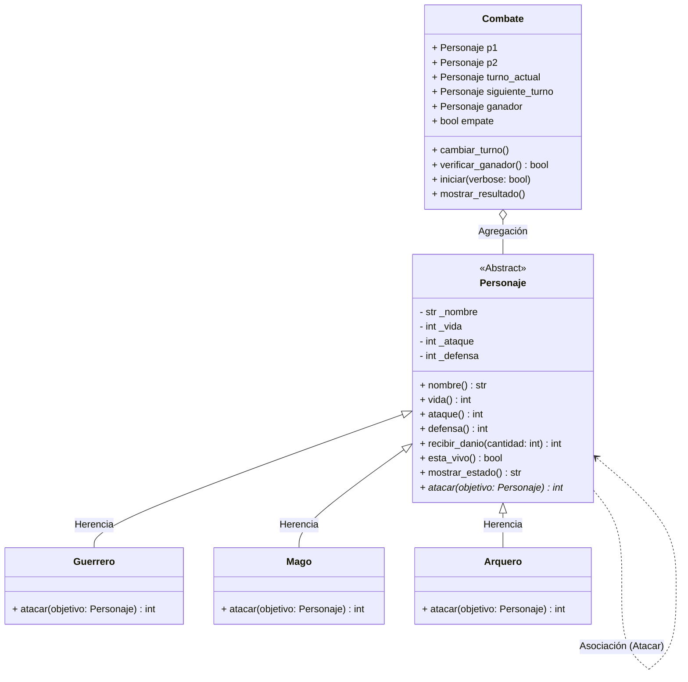

# Guardians of the Ancient Kingdom

**Proyecto Integrador — Parcial II (Programación Orientada a Objetos)**  
**Estudiante:** Sebastian De Luque Garcia  
**Asignatura:** Programación Orientada a Objetos con Python  


## 1. Descripción del Proyecto

**Guardians of the Ancient Kingdom** es un sistema de combate por turnos programado en Python que simula los enfrentamientos entre tres órdenes de guardianes del reino de Eldoria: **Guerreros**, **Magos** y **Arqueros**.

El proyecto resuelve la necesidad de automatizar los combates, controlando de forma segura las reglas de ataque de cada personaje, el cálculo de daño según su habilidad especial, las validaciones de vida y el flujo de turnos hasta determinar un vencedor o un empate.

## Esquema del proyecto

A continuación se muestra el esquema completo de archivos y directorios que componen el proyecto:

```text
Guardians-of-the-Ancient-Kingdom/
│
├── personajes.py        # Módulo con la clase abstracta Personaje, subclases y lógica de Combate
├── main.py              # Script principal con pruebas manuales, simulación y suite Pytest
└── README.md            # Documentación general y respuestas teóricas
```

### Acceso Directo a los Archivos del Proyecto
* **Lógica principal y clases:** [`personajes.py`](./personajes.py)
* **Ejecución y suite de pruebas:** [`main.py`](./main.py)


## 2. Estructura del Repositorio

- `personajes.py`: Contiene la definición de la clase base abstracta `Personaje`, las subclases (`Guerrero`, `Mago`, `Arquero`) y la clase `Combate`. Define la lógica, el encapsulamiento y los comportamientos del sistema.
- `main.py`: Archivo principal encargado de instanciar los objetos, demostrar los casos de prueba manuales y ejecutar la suite de pruebas automatizadas con Pytest.
- `README.md`: Documentación completa del sistema, explicaciones teóricas/prácticas de POO y evidencia de los retos adicionales.


## 3. Clases y Responsabilidades

- **`Personaje` (Clase Abstracta):** Define y encapsula los atributos comunes (`nombre`, `vida`, `ataque`, `defensa`). Contiene los métodos compartidos como `recibir_danio()`, `esta_vivo()` y define la firma abstracta de `atacar(objetivo)`.
- **`Guerrero` (Subclase):** Aplica la habilidad *Golpe poderoso* (aumenta su ataque un 20% antes de restar la defensa enemiga).
- **`Mago` (Subclase):** Aplica la habilidad *Hechizo penetrante* (ignora completamente la defensa del rival).
- **`Arquero` (Subclase):** Aplica la habilidad *Disparo crítico* (duplica el daño base si su ataque supera la defensa).
- **`Combate`:** Administrador independiente del enfrentamiento. Maneja turnos, verifica condiciones de victoria, límites de rondas y empates técnicos.


## 4. Relaciones entre Clases

1. **Herencia:** `Guerrero`, `Mago` y `Arquero` heredan de `Personaje` (`Guerrero is-a Personaje`).
2. **Asociación:** Ocurre cuando un personaje ejecuta `atacar(objetivo)`, interactuando directamente con el método `recibir_danio()` de la instancia objetivo.
3. **Agregación:** La clase `Combate` recibe dos objetos `Personaje` creados independientemente fuera de ella (`Combate has-a Personaje`).


## 5. Aplicación de Conceptos de POO

- **Abstracción:** Se modela la esencia de un combatiente en `Personaje` sin permitir instancias directas, delegando la implementación específica del ataque a las subclases.
- **Encapsulamiento:** Atributos protegidos con prefijo `_` (`_nombre`, `_vida`, `_ataque`, `_defensa`) accesibles mediante getters y setters con validaciones estrictas.
- **Polimorfismo:** En `Combate`, la llamada `atacante.atacar(defensor)` ejecuta dinámicamente la habilidad especial de cada subclase sin necesidad de condicionales sobre el tipo de objeto.


## 6. Lógica de Combate y Reglas de Daño

- **Guerrero:** `Daño = máximo(0, floor(ataque * 1.20) - defensa_objetivo)`
- **Mago:** `Daño = ataque_mago` (ignora la defensa enemiga)
- **Arquero:** Si `ataque > defensa_objetivo`, `Daño = (ataque - defensa_objetivo) * 2`. De lo contrario, `0`.


## 7. Instrucciones de Ejecución

1. **Clonar el repositorio:**
   ```bash
   git clone <URL_DE_TU_REPOSITORIO>
   cd Guardians-of-the-Ancient-Kingdom
   ```

2. **Ejecutar simulación y pruebas manuales:**
   ```bash
   python main.py
   ```

3. **Ejecutar pruebas automatizadas con Pytest:**
   ```bash
   pip install pytest
   pytest main.py
   ```


## 8. Casos de Prueba Verificados

Se verificaron los 12 casos obligatorios exigidos:

* **1.** Creación correcta de los tres tipos de personajes.
* **2.** Rechazo de valores de vida superiores a 100 o negativos.
* **3.** Rechazo de nombres vacíos.
* **4.** Rechazo de ataques y defensas fuera de los rangos válidos.
* **5.** Cálculo del ataque potenciado del Guerrero.
* **6.** Aplicación del ataque del Mago ignorando defensa.
* **7.** Disparo crítico del Arquero cuando supera la defensa.
* **8.** Control de vida mínima en cero (sin valores negativos).
* **9.** Bloqueo de ataque si el atacante está derrotado.
* **10.** Simulación completa de combate por turnos.
* **11.** Determinación y reporte del ganador.
* **12.** Finalización por empate técnico cuando ningún personaje causa daño.


---


# RETOS PARA LA CALIFICACIÓN MÁXIMA (5.0)


## Reto Extra 1 — Diagrama de Clases UML



### Explicación del Diagrama
- **Clase Abstracta:** `Personaje` se denota con `<<Abstract>>` y su método abstracto `atacar()` lleva un asterisco `*`.
- **Herencia (`<|--`):** Muestra cómo `Guerrero`, `Mago` y `Arquero` heredan de `Personaje`.
- **Agregación (`o--`):** Muestra que `Combate` recibe dos objetos `Personaje` creados independientemente.
- **Asociación (`..>`):** Representa la interacción cuando un personaje ataca e invoca métodos en el otro.


## Reto Extra 2 — Pruebas Automatizadas con Pytest

Para automatizar la verificación de las reglas del sistema, se integraron pruebas con `pytest` en `main.py` que evalúan:
- Creación válida de personajes e imposibilidad de instanciar la clase abstracta.
- Rechazo de atributos inválidos mediante excepciones (`ValueError`, `TypeError`).
- Cálculo exacto de daño para cada habilidad especial.
- Garantía de que la vida no sea negativa.
- Restricción de ataque para personajes derrotados.
- Determinación adecuada del ganador en un combate.

### Ejecución y Evidencia

Para correr las pruebas en la terminal:
```bash
pytest main.py -v
```

**Resultado de la ejecución:**
```text
============================= test session starts ==============================
platform linux -- Python 3.x, pytest-8.x
collected 6 items

main.py::test_creacion_personaje_valido PASSED                            [ 16%]
main.py::test_rechazo_valores_incorrectos PASSED                         [ 33%]
main.py::test_calculo_danio_clases PASSED                                [ 50%]
main.py::test_vida_no_negativa PASSED                                    [ 66%]
main.py::test_personaje_derrotado_no_puede_atacar PASSED                [ 83%]
main.py::test_combate_resultado_ganador PASSED                           [100%]

============================== 6 passed in 0.12s ===============================
```


## Reto Extra 3 — Desafío de Abstracción

### ¿Por qué `atacar()` debe ser abstracto, pero `recibir_danio()` puede estar implementado en la clase base?

La razón fundamental de esta decisión de diseño responde a la **variabilidad del comportamiento versus la reutilización de código**:

1. **Variabilidad y Polimorfismo (`atacar()`):**  
   Cada orden de guardianes ejecuta su ataque de forma distinta según sus reglas únicas: el Guerrero potencia su golpe un 20%, el Mago ignora la defensa del rival, y el Arquero aplica un multiplicador crítico si supera la defensa. Como la clase base `Personaje` **no puede predeterminar la fórmula de ataque de subclases actuales o futuras**, declara `atacar()` como un método abstracto (`@abstractmethod`). Esto establece un contrato obligatorio para que cada subclase implemente su variante polimórfica específica.

2. **Reutilización y Consistencia (`recibir_danio()`):**  
   Por el contrario, la mecánica de recibir daño es **idéntica y consistente para todos los personajes**: tomar la cantidad de daño calculada, descontarla de la vida actual y garantizar que el valor nunca descienda de 0. Dado que este comportamiento no cambia según el tipo de personaje, implementar `recibir_danio()` directamente en la clase base `Personaje` permite reutilizar la lógica (principio DRY - *Don't Repeat Yourself*) y centraliza el control del encapsulamiento de la salud en un solo punto.
